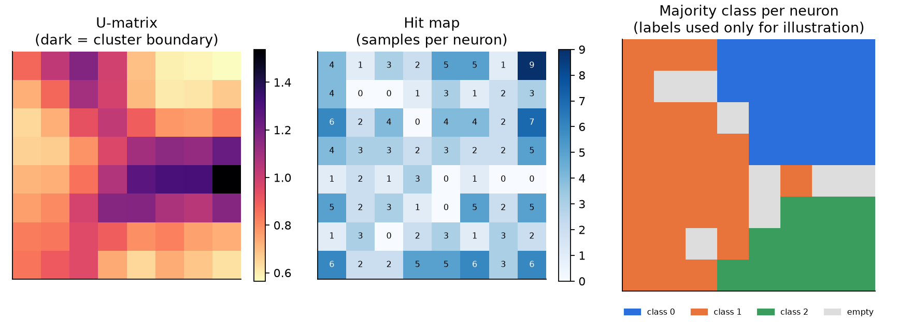
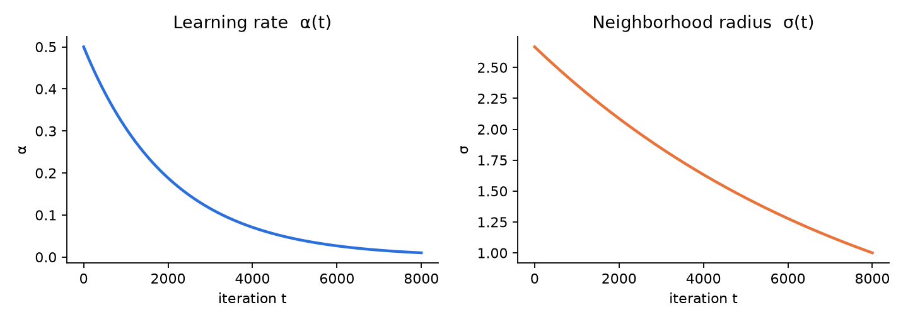
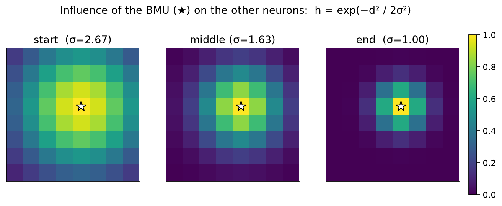
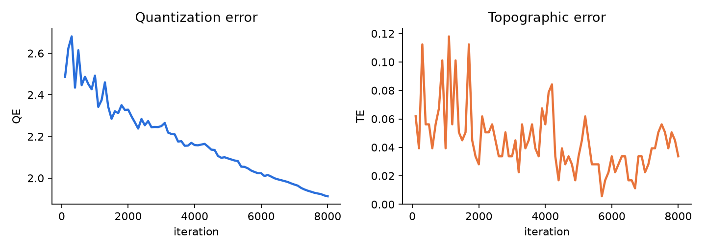

# Self-Organizing Map (SOM) from Scratch with PyTorch

A **Self-Organizing Map** (Kohonen map) that I implemented from scratch: the Best Matching Unit search, the neighborhood function, the learning-rate decay, the evaluation metrics, and the visualizations. It does not use a ready-made SOM library such as MiniSom.

The class is ready to use: copy one file, pass in tabular data, and you get a trained map, a *hit map*, a *U-matrix*, and the *quantization error* and *topographic error* metrics.



*Example on the Wine dataset (178 samples, 13 features), 8×8 map. Class labels are not used for training. They are only used in the right-hand panel for illustration.*

---

## Table of contents

1. [What I built from scratch](#what-i-built-from-scratch)
2. [How a SOM works](#how-a-som-works)
3. [Evaluation and visualization](#evaluation-and-visualization)
4. [Quick start](#quick-start)
5. [Parameters, methods, and attributes](#parameters-methods-and-attributes)
6. [Scope and limitations](#scope-and-limitations)
7. [Roadmap](#roadmap)
8. [References](#references)

---

## What I built from scratch

All of the SOM logic lives in [`neural_network.py`](neural_network.py):

- **Best Matching Unit (BMU)** search for one sample or many samples at once,
- exponentially decaying **learning rate** and **neighborhood radius**,
- a **Gaussian neighborhood function** based on the distance between neurons on the grid,
- the online **weight update rule** (one sample per iteration),
- **quantization error**, **topographic error**, **hit map**, and **U-matrix**,
- input validation, flexible data handling (DataFrame, array, list, tensor, even flattened images), built-in feature standardization, and **reproducible results** through `random_state`.

The libraries are only supporting tools: **PyTorch** for tensor operations, **NumPy/pandas** for reading data, and **scikit-learn** only for `StandardScaler` (feature standardization). The SOM algorithm itself does not come from any library.

Because the class is self-contained and documented (docstrings on the class and its methods), you can use it on your own data, read the code to learn how a SOM works, or extend it.

---

## How a SOM works

A SOM is an **unsupervised** neural network that maps high-dimensional data onto a 2D grid you can look at. Every point on the grid is a **neuron** that stores one weight vector with the same dimension as the data. During training the weights are adjusted so that neurons that are **close on the grid** represent **similar** data.

### One training iteration

For every iteration $t = 0, 1, \dots, T-1$:

1. Draw one random sample $x$.
2. Find the most similar neuron, the **BMU**.
3. Compute $\alpha(t)$ and $\sigma(t)$ (both shrink over time).
4. Compute how strongly the BMU influences every other neuron, $h_{cj}(t)$.
5. Move the weights of all neurons toward the sample.

### 1. Best Matching Unit (BMU)

The BMU is the neuron whose weight vector is closest (Euclidean distance) to the sample:

$$c = \arg\min_j \lVert x - w_j \rVert$$

### 2. Learning rate

The learning rate controls how far the weights move in one step. It starts large so the map adapts quickly, then shrinks so the map settles:

$$\alpha(t) = \alpha_0 \, e^{-t/\tau}, \qquad \tau = \frac{T}{\ln(\alpha_0/\alpha_f)}$$

The constant $\tau$ is chosen so that the learning rate decays from $\alpha_0$ (`learning_rate`) to approximately $\alpha_f$ (`lr_final`) at the end of training.

### 3. Neighborhood function (Gaussian)

This is what makes a SOM preserve **topology**. Not only the BMU moves: its neighbors on the grid are pulled toward the sample too, more strongly the closer they are:

$$h_{cj}(t) = \exp\left(-\frac{d_{cj}^{2}}{2\,\sigma(t)^{2}}\right)$$

where $d_{cj}$ is the distance between neuron $j$ and the BMU $c$ **on the grid** (not in data space). The radius $\sigma$ also decays exponentially:

$$\sigma(t) = \sigma_0 \, e^{-t/\lambda}, \qquad \lambda = \frac{T}{\ln(\sigma_0/\sigma_f)}$$

At the start the radius is large, so the whole map is pulled together and a global layout forms. At the end the radius is small, so each neuron fine-tunes locally.





### 4. Weight update

$$w_j(t+1) = w_j(t) + \alpha(t)\, h_{cj}(t)\, \bigl(x - w_j(t)\bigr)$$

Every neuron moves toward the sample by a fraction $\alpha(t)\,h_{cj}(t)$ of its distance. Neurons close to the BMU move a lot, and distant ones barely move.

---

## Evaluation and visualization

A SOM has no single "accuracy" number, so the result is read through a few metrics and maps.



### Quantization error (QE)

The average distance between each sample and its BMU:

$$\mathrm{QE} = \frac{1}{N}\sum_{i=1}^{N} \lVert x_i - w_{c(i)} \rVert$$

Lower means the map represents the data better. Keep in mind that it is computed on the **standardized data**, so it is only comparable within the same dataset, and it decreases as you add neurons.

### Topographic error (TE)

The fraction of samples whose **first and second BMU are not adjacent** on the grid. It measures whether topology is preserved: a low TE means similar data really is placed close together. Two neurons count as neighbors when their grid distance is 1 (diagonal neighbors count as not adjacent).

### Hit map

The number of samples each neuron "wins". Neurons with large counts represent dense groups of data. Neurons with a count of 0 are never a BMU. They are typically the "bridge" neurons between groups.

### U-matrix

For each neuron, the average distance between its weight vector and those of its four neighbors (up, down, left, right) in data space. **High** values (dark in the palette above) mark **boundaries between clusters**, and **low** values mark the inside of a cluster. The U-matrix is the main way to read cluster structure from a SOM without choosing the number of clusters in advance.

### Example result on the Wine dataset

8×8 map, 8,000 iterations, features standardized automatically:

| Measure | Result |
|---|---|
| Quantization error | ≈ 2.49 (iteration 100) → ≈ 1.91 (iteration 8,000) |
| Final topographic error | ≈ 0.03 |
| Empty neurons | 8 of 64 |
| Agreement with the class labels | 97.8% of samples sit on a neuron whose majority class equals their own class |

The last figure is only an illustration. Labels are not used during training, but the number is computed on the training data and rises when neurons are added, so it is not a measure of generalization.

---

## Quick start

**Requirements:** tested with Python 3.11, PyTorch 2.14, NumPy 2.4, pandas 3.0, scikit-learn 1.9, and matplotlib 3.11.

```bash
pip install torch numpy pandas scikit-learn matplotlib
```

Copy [`neural_network.py`](neural_network.py) into your project, then:

```python
import pandas as pd
import matplotlib.pyplot as plt
from sklearn.datasets import load_wine
from neural_network import SelfOrganizingMaps

X = load_wine(as_frame=True).data                      # any tabular data

# 1. Train
som = SelfOrganizingMaps(data=X, x_neuron=8, y_neuron=8, n_iter=8000, random_state=42)
som.fit_train(steps=100)                               # record QE/TE every 100 iterations

# 2. Map samples to neurons
bmu, index_bmu, distance = som.predict()               # training data
bmu_new, idx_new, d_new = som.predict(X.iloc[:5])      # new data, original units

# 3. Results
hit_map  = som.heat_maps()                             # tensor (8, 8)
u_matrix = som.u_matrix()                              # tensor (8, 8)

# 4. Profile of every neuron in the original data units
w_original = som.scaler.inverse_transform(som.final_weight.numpy())
profile = pd.DataFrame(w_original, columns=X.columns)

# 5. Visualize
fig, ax = plt.subplots(1, 3, figsize=(12, 3.5))
ax[0].imshow(u_matrix.numpy(), cmap="magma_r"); ax[0].set_title("U-matrix")
ax[1].imshow(hit_map.numpy(),  cmap="Blues");   ax[1].set_title("Hit map")
ax[2].plot(som.iter_steps, [float(q) for q in som.quantization_err])
ax[2].set_title("Quantization error")
plt.show()
```

Tips for reading the results:

- Neuron `k` sits at grid row `k // y_neuron` and column `k % y_neuron`.
- `predict(data)` expects data in the **original units** (DataFrame, array, list, or tensor) and scales it with the scaler learned during training. Do not pass `som.data`, which is already scaled.
- The weights (`final_weight`) and the distances are in **scaled units**. Use `scaler.inverse_transform` to read a neuron's profile in the original units.
- The same `random_state` gives identical results, including when `fit_train` is called repeatedly.

---

## Parameters, methods, and attributes

### `SelfOrganizingMaps` parameters

| Parameter | Default | Description |
|---|---|---|
| `data` | – | Training data `(n_samples, n_features)`: DataFrame, array, list, or tensor. Must not contain missing or infinite values |
| `x_neuron`, `y_neuron` | 10, 10 | Grid size (rows, columns). At least 2 neurons |
| `n_iter` | 2000 | Number of training iterations (one random sample per iteration) |
| `learning_rate` | 0.5 | Initial learning rate $\alpha_0$ |
| `lr_final` | 0.01 | Final learning rate $\alpha_f$ (must be smaller than `learning_rate`) |
| `sigma` | automatic | Initial radius $\sigma_0$. If omitted: `max(x_neuron, y_neuron) / 3` |
| `sigma_f` | automatic | Final radius $\sigma_f$. If omitted: `min(1.0, sigma / 2)` |
| `normalize` | `True` | Standardize features (mean 0, standard deviation 1). Turn off if your data is already standardized |
| `random_state` | 42 | Seed (non-negative integer) |

### Methods

| Method | Purpose |
|---|---|
| `fit_train(steps=10)` | Trains the map and records QE and TE every `steps` iterations. Returns the model itself |
| `predict(data=None)` | BMUs for new data (or for the training data if omitted). Returns `(bmu, index_bmu, distance)` |
| `heat_maps()` | Hit map of shape `(x_neuron, y_neuron)` |
| `u_matrix()` | U-matrix of shape `(x_neuron, y_neuron)` |
| `quantization_error(weight)`, `topographic_error(weight)` | Metrics for a given set of weights |

### Attributes available after training

`final_weight`, `quantization_err`, `topographic_err`, `iter_steps`, `scaler`, `data` (scaled training data), and `D_grid` (distances between neurons on the grid).

---

## Scope and limitations

Implemented:

- rectangular grid,
- exponential decay of the learning rate and the radius,
- Gaussian neighborhood,
- Euclidean distance.

Several parameters (`grid_shape`, `decay_function`, `neighborhood_function`, `weight_init`, `d_type`) already exist in the signature as scaffolding for future work, but **only the defaults listed above work today**. Choosing another value does not change the model's behavior.

Other limitations:

- Training is **online**, one sample per iteration. For large datasets, increase `n_iter` and use a large `steps`, because QE and TE are computed over the whole dataset every time they are recorded.
- A SOM is **exploratory**, not predictive, and the result is sensitive to the grid size, the radius, and the learning rate.
- Features with very different scales strongly affect the result, which is why `normalize=True` is the default.

---

## Roadmap

- A real-world case study: mapping air-quality patterns in Kalimantan, Indonesia, using near-real-time data (*in planning*).
- Implement the options that are still scaffolding: linear/geometric decay, bubble neighborhood, Manhattan/cosine distance, and a hexagonal grid.
- Automated tests (`pytest`) and a comparison with other SOM libraries.
- Batch SOM training mode.

---

## References

- T. Kohonen, "Self-organized formation of topologically correct feature maps", *Biological Cybernetics*, 43, 1982.
- T. Kohonen, "The self-organizing map", *Proceedings of the IEEE*, 78(9), 1990.
- A. Ultsch, "Self-organizing neural networks for visualisation and classification", 1993 (U-matrix).
- K. Kiviluoto, "Topology preservation in self-organizing maps", *IEEE ICNN*, 1996 (topographic error).

---

## License

Released under the [MIT License](LICENSE). You are free to use, modify, and distribute this code, as long as the copyright notice and the license text are kept.

---

## Author

**Muhammad Ikrar** · [LinkedIn](https://www.linkedin.com/in/ikrar-muhammad/) · [GitHub](https://github.com/ikrarmuhamad)
